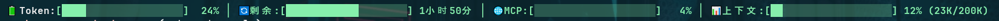

# CLAUDE-GLM-HUD

> Claude Code 状态栏插件：实时显示智谱 AI Token 使用率和上下文窗口信息
>完全使用ClaudeCode+GLM-4.7生产的工具


## 功能特性

- **上下文窗口显示** - 实时显示当前会话的上下文使用情况
- **Token 使用率** - 显示智谱 AI 的 Token 使用配额
- **MCP 使用率** - 显示 MCP 服务器的时间使用率
- **彩色进度条** - 直观的薄荷绿进度条可视化
- **智能缓存** - 上下文数据缓存，思考过程显示更稳定

## 显示效果

```

```

## 安装

### 快速安装

1. **下载项目**：从 GitHub Releases 下载 zip 文件并解压
2. **运行安装脚本**：

**Windows:**
```bash
install.bat

或者在ClaudeCode中 【@一键安装.md】
```

**Linux/macOS:**
```bash
chmod +x install.sh
./install.sh
```

### 安装说明

- **不需要 Git**，直接下载 zip 即可
- 安装脚本会自动完成构建、复制文件、配置状态栏
- **安装后当前目录可删除**，插件已复制到 `~/.claude/plugins/claude-glm-hud/`

详见 [一键安装.md](./一键安装.md)

## 前置条件

使用此插件前，请确保您的 `~/.claude/settings.json` 中已配置智谱 AI 的 API Token：

```json
{
  "env": {
    "ANTHROPIC_AUTH_TOKEN": "您的智谱AI_API_Token"
  }
}
```

## 开发

```bash
# 安装依赖
npm install

# 开发模式
npm run dev

# 构建
npm run build

# 监听模式
npm run watch
```

## 技术栈

- TypeScript
- Node.js 18+
- esbuild

## 架构说明

```
src/
├── index.ts          # 主入口
├── types.ts          # 类型定义
├── constants.ts      # 常量
├── stdin.ts          # stdin JSON 解析
├── config.ts         # AUTH_TOKEN 配置
├── glm-api.ts        # GLM API 集成
├── cache.ts          # 缓存管理
└── render/           # 渲染模块
    ├── index.ts      # 渲染协调器
    └── utils.ts      # 工具函数
```

## 常见问题

### 状态栏不显示

优先重新执行 `@一键安装.md`，确认 `~/.claude/settings.json` 中的 `statusLine` 配置已正确写入。

### 上下文数据不更新

确保使用 Claude Code v2.1.6+，该版本支持 context_window 数据。

### GLM API 调用失败

检查 `~/.claude/settings.json` 中的 `GLM_API_KEY` 配置是否正确。

## 许可证

MIT
